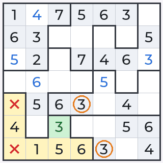

<!-- Written by tools/walkthrough.py jigsaw-7x7: edit the script, not this page. -->
# Jigsaw 7x7, step 6: the 3 in region 6

**Step 6 of 25** · [← Step 5](step-05.md) · [All steps](../jigsaw-7x7.md#the-whole-puzzle-step-by-step) · [Step 7 →](step-07.md)

Region 6 needs a 3. r5c1: row 5 has one (r5c4). r7c1: row 7 has one (r7c5). Only **r6c3** is left: **r6c3 = 3**.

**Step 6 of 25** · [← Step 5](step-05.md) · [All steps](../jigsaw-7x7.md#the-whole-puzzle-step-by-step) · [Step 7 →](step-07.md)
