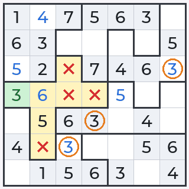

<!-- Written by tools/walkthrough.py jigsaw-7x7: edit the script, not this page. -->
# Jigsaw 7x7, step 7: the 3 in region 4

**Step 7 of 25** · [← Step 6](step-06.md) · [All steps](../jigsaw-7x7.md#the-whole-puzzle-step-by-step) · [Step 8 →](step-08.md)

Region 4 needs a 3. r3c3: row 3 has one (r3c7). r4c3: column 3 has one (r6c3). r4c4: column 4 has one (r5c4). r6c2: row 6 has one (r6c3). Only **r4c1** is left: **r4c1 = 3**.

**Step 7 of 25** · [← Step 6](step-06.md) · [All steps](../jigsaw-7x7.md#the-whole-puzzle-step-by-step) · [Step 8 →](step-08.md)
