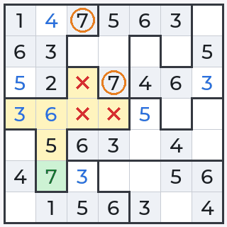

<!-- Written by tools/walkthrough.py jigsaw-7x7: edit the script, not this page. -->
# Jigsaw 7x7, step 8: the 7 in region 4

**Step 8 of 25** · [← Step 7](step-07.md) · [All steps](../jigsaw-7x7.md#the-whole-puzzle-step-by-step) · [Step 9 →](step-09.md)

Region 4 needs a 7. r3c3: row 3 has one (r3c4). r4c3: column 3 has one (r1c3). r4c4: column 4 has one (r3c4). Only **r6c2** is left: **r6c2 = 7**.

**Step 8 of 25** · [← Step 7](step-07.md) · [All steps](../jigsaw-7x7.md#the-whole-puzzle-step-by-step) · [Step 9 →](step-09.md)
