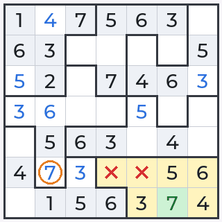

<!-- Written by tools/walkthrough.py jigsaw-7x7: edit the script, not this page. -->
# Jigsaw 7x7, step 9: the 7 in region 7

**Step 9 of 25** · [← Step 8](step-08.md) · [All steps](../jigsaw-7x7.md#the-whole-puzzle-step-by-step) · [Step 10 →](step-10.md)

Region 7 needs a 7. r6c4 and r6c5: row 6 has one (r6c2). Only **r7c6** is left: **r7c6 = 7**.

**Step 9 of 25** · [← Step 8](step-08.md) · [All steps](../jigsaw-7x7.md#the-whole-puzzle-step-by-step) · [Step 10 →](step-10.md)
