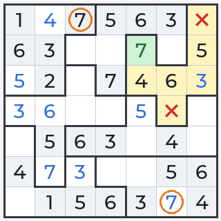

<!-- Written by tools/walkthrough.py jigsaw-7x7: edit the script, not this page. -->
# Jigsaw 7x7, step 10: the 7 in region 2

**Step 10 of 25** · [← Step 9](step-09.md) · [All steps](../jigsaw-7x7.md#the-whole-puzzle-step-by-step) · [Step 11 →](step-11.md)

Region 2 needs a 7. r1c7: row 1 has one (r1c3). r4c6: column 6 has one (r7c6). Only **r2c5** is left: **r2c5 = 7**.

**Step 10 of 25** · [← Step 9](step-09.md) · [All steps](../jigsaw-7x7.md#the-whole-puzzle-step-by-step) · [Step 11 →](step-11.md)
