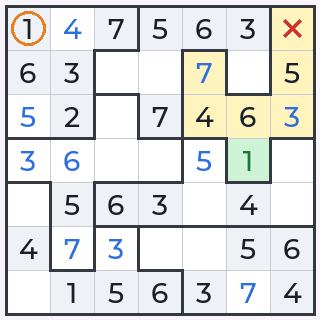

<!-- Written by tools/walkthrough.py jigsaw-7x7: edit the script, not this page. -->
# Jigsaw 7x7, step 11: the 1 in region 2

**Step 11 of 25** · [← Step 10](step-10.md) · [All steps](../jigsaw-7x7.md#the-whole-puzzle-step-by-step) · [Step 12 →](step-12.md)

Region 2 needs a 1. r1c7: row 1 has one (r1c1). Only **r4c6** is left: **r4c6 = 1**.

**Step 11 of 25** · [← Step 10](step-10.md) · [All steps](../jigsaw-7x7.md#the-whole-puzzle-step-by-step) · [Step 12 →](step-12.md)
