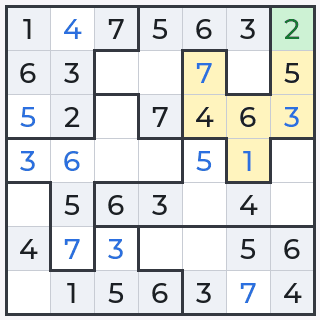

<!-- Written by tools/walkthrough.py jigsaw-7x7: edit the script, not this page. -->
# Jigsaw 7x7, step 12: the 2 in region 2

**Step 12 of 25** · [← Step 11](step-11.md) · [All steps](../jigsaw-7x7.md#the-whole-puzzle-step-by-step) · [Step 13 →](step-13.md)

Region 2 needs a 2, and r1c7 is its last empty cell: **r1c7 = 2**.

**Step 12 of 25** · [← Step 11](step-11.md) · [All steps](../jigsaw-7x7.md#the-whole-puzzle-step-by-step) · [Step 13 →](step-13.md)
