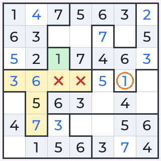

<!-- Written by tools/walkthrough.py jigsaw-7x7: edit the script, not this page. -->
# Jigsaw 7x7, step 13: the 1 in region 4

**Step 13 of 25** · [← Step 12](step-12.md) · [All steps](../jigsaw-7x7.md#the-whole-puzzle-step-by-step) · [Step 14 →](step-14.md)

Region 4 needs a 1. r4c3 and r4c4: row 4 has one (r4c6). Only **r3c3** is left: **r3c3 = 1**.

**Step 13 of 25** · [← Step 12](step-12.md) · [All steps](../jigsaw-7x7.md#the-whole-puzzle-step-by-step) · [Step 14 →](step-14.md)
