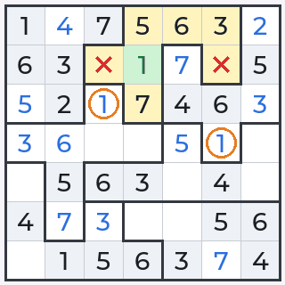

<!-- Written by tools/walkthrough.py jigsaw-7x7: edit the script, not this page. -->
# Jigsaw 7x7, step 14: the 1 in region 3

**Step 14 of 25** · [← Step 13](step-13.md) · [All steps](../jigsaw-7x7.md#the-whole-puzzle-step-by-step) · [Step 15 →](step-15.md)

Region 3 needs a 1. r2c3: column 3 has one (r3c3). r2c6: column 6 has one (r4c6). Only **r2c4** is left: **r2c4 = 1**.

**Step 14 of 25** · [← Step 13](step-13.md) · [All steps](../jigsaw-7x7.md#the-whole-puzzle-step-by-step) · [Step 15 →](step-15.md)
