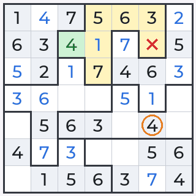

<!-- Written by tools/walkthrough.py jigsaw-7x7: edit the script, not this page. -->
# Jigsaw 7x7, step 15: the 4 in region 3

**Step 15 of 25** · [← Step 14](step-14.md) · [All steps](../jigsaw-7x7.md#the-whole-puzzle-step-by-step) · [Step 16 →](step-16.md)

Region 3 needs a 4. r2c6: column 6 has one (r5c6). Only **r2c3** is left: **r2c3 = 4**.

**Step 15 of 25** · [← Step 14](step-14.md) · [All steps](../jigsaw-7x7.md#the-whole-puzzle-step-by-step) · [Step 16 →](step-16.md)
