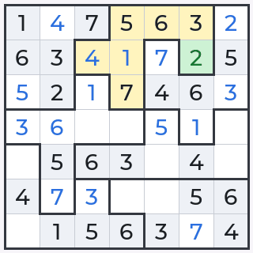

<!-- Written by tools/walkthrough.py jigsaw-7x7: edit the script, not this page. -->
# Jigsaw 7x7, step 16: the 2 in region 3

**Step 16 of 25** · [← Step 15](step-15.md) · [All steps](../jigsaw-7x7.md#the-whole-puzzle-step-by-step) · [Step 17 →](step-17.md)

Region 3 needs a 2, and r2c6 is its last empty cell: **r2c6 = 2**.

**Step 16 of 25** · [← Step 15](step-15.md) · [All steps](../jigsaw-7x7.md#the-whole-puzzle-step-by-step) · [Step 17 →](step-17.md)
