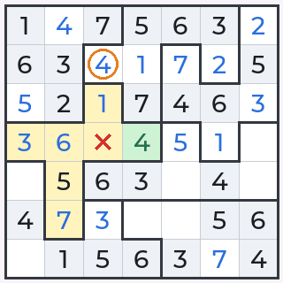

<!-- Written by tools/walkthrough.py jigsaw-7x7: edit the script, not this page. -->
# Jigsaw 7x7, step 17: the 4 in region 4

**Step 17 of 25** · [← Step 16](step-16.md) · [All steps](../jigsaw-7x7.md#the-whole-puzzle-step-by-step) · [Step 18 →](step-18.md)

Region 4 needs a 4. r4c3: column 3 has one (r2c3). Only **r4c4** is left: **r4c4 = 4**.

**Step 17 of 25** · [← Step 16](step-16.md) · [All steps](../jigsaw-7x7.md#the-whole-puzzle-step-by-step) · [Step 18 →](step-18.md)
