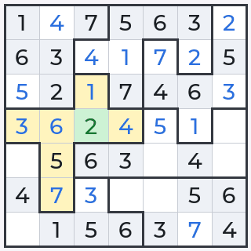

<!-- Written by tools/walkthrough.py jigsaw-7x7: edit the script, not this page. -->
# Jigsaw 7x7, step 18: the 2 in region 4

**Step 18 of 25** · [← Step 17](step-17.md) · [All steps](../jigsaw-7x7.md#the-whole-puzzle-step-by-step) · [Step 19 →](step-19.md)

Region 4 needs a 2, and r4c3 is its last empty cell: **r4c3 = 2**.

**Step 18 of 25** · [← Step 17](step-17.md) · [All steps](../jigsaw-7x7.md#the-whole-puzzle-step-by-step) · [Step 19 →](step-19.md)
