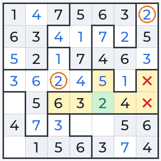

<!-- Written by tools/walkthrough.py jigsaw-7x7: edit the script, not this page. -->
# Jigsaw 7x7, step 19: the 2 in region 5

**Step 19 of 25** · [← Step 18](step-18.md) · [All steps](../jigsaw-7x7.md#the-whole-puzzle-step-by-step) · [Step 20 →](step-20.md)

Region 5 needs a 2. r4c7: row 4 has one (r4c3). r5c7: column 7 has one (r1c7). Only **r5c5** is left: **r5c5 = 2**.

**Step 19 of 25** · [← Step 18](step-18.md) · [All steps](../jigsaw-7x7.md#the-whole-puzzle-step-by-step) · [Step 20 →](step-20.md)
