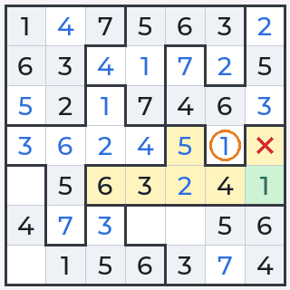

<!-- Written by tools/walkthrough.py jigsaw-7x7: edit the script, not this page. -->
# Jigsaw 7x7, step 20: the 1 in region 5

**Step 20 of 25** · [← Step 19](step-19.md) · [All steps](../jigsaw-7x7.md#the-whole-puzzle-step-by-step) · [Step 21 →](step-21.md)

Region 5 needs a 1. r4c7: row 4 has one (r4c6). Only **r5c7** is left: **r5c7 = 1**.

**Step 20 of 25** · [← Step 19](step-19.md) · [All steps](../jigsaw-7x7.md#the-whole-puzzle-step-by-step) · [Step 21 →](step-21.md)
