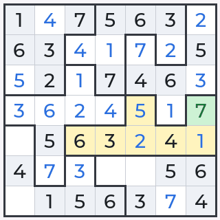

<!-- Written by tools/walkthrough.py jigsaw-7x7: edit the script, not this page. -->
# Jigsaw 7x7, step 21: the 7 in region 5

**Step 21 of 25** · [← Step 20](step-20.md) · [All steps](../jigsaw-7x7.md#the-whole-puzzle-step-by-step) · [Step 22 →](step-22.md)

Region 5 needs a 7, and r4c7 is its last empty cell: **r4c7 = 7**.

**Step 21 of 25** · [← Step 20](step-20.md) · [All steps](../jigsaw-7x7.md#the-whole-puzzle-step-by-step) · [Step 22 →](step-22.md)
