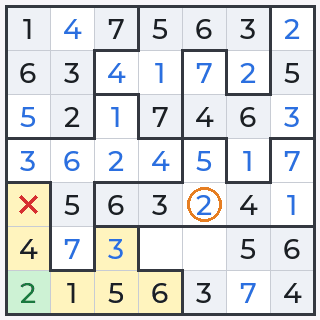

<!-- Written by tools/walkthrough.py jigsaw-7x7: edit the script, not this page. -->
# Jigsaw 7x7, step 22: the 2 in region 6

**Step 22 of 25** · [← Step 21](step-21.md) · [All steps](../jigsaw-7x7.md#the-whole-puzzle-step-by-step) · [Step 23 →](step-23.md)

Region 6 needs a 2. r5c1: row 5 has one (r5c5). Only **r7c1** is left: **r7c1 = 2**.

**Step 22 of 25** · [← Step 21](step-21.md) · [All steps](../jigsaw-7x7.md#the-whole-puzzle-step-by-step) · [Step 23 →](step-23.md)
