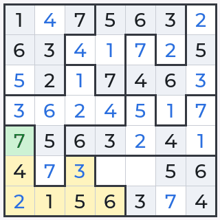

<!-- Written by tools/walkthrough.py jigsaw-7x7: edit the script, not this page. -->
# Jigsaw 7x7, step 23: the 7 in region 6

**Step 23 of 25** · [← Step 22](step-22.md) · [All steps](../jigsaw-7x7.md#the-whole-puzzle-step-by-step) · [Step 24 →](step-24.md)

Region 6 needs a 7, and r5c1 is its last empty cell: **r5c1 = 7**.

**Step 23 of 25** · [← Step 22](step-22.md) · [All steps](../jigsaw-7x7.md#the-whole-puzzle-step-by-step) · [Step 24 →](step-24.md)
