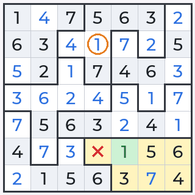

<!-- Written by tools/walkthrough.py jigsaw-7x7: edit the script, not this page. -->
# Jigsaw 7x7, step 24: the 1 in region 7

**Step 24 of 25** · [← Step 23](step-23.md) · [All steps](../jigsaw-7x7.md#the-whole-puzzle-step-by-step) · [Step 25 →](step-25.md)

Region 7 needs a 1. r6c4: column 4 has one (r2c4). Only **r6c5** is left: **r6c5 = 1**.

**Step 24 of 25** · [← Step 23](step-23.md) · [All steps](../jigsaw-7x7.md#the-whole-puzzle-step-by-step) · [Step 25 →](step-25.md)
