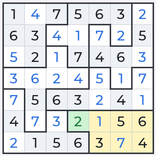

<!-- Written by tools/walkthrough.py jigsaw-7x7: edit the script, not this page. -->
# Jigsaw 7x7, step 25: the 2 in region 7

**Step 25 of 25** · [← Step 24](step-24.md) · [All steps](../jigsaw-7x7.md#the-whole-puzzle-step-by-step) · [All steps](../jigsaw-7x7.md#the-whole-puzzle-step-by-step)

Region 7 needs a 2, and r6c4 is its last empty cell: **r6c4 = 2**.

Solved.

**Step 25 of 25** · [← Step 24](step-24.md) · [All steps](../jigsaw-7x7.md#the-whole-puzzle-step-by-step) · [All steps](../jigsaw-7x7.md#the-whole-puzzle-step-by-step)
