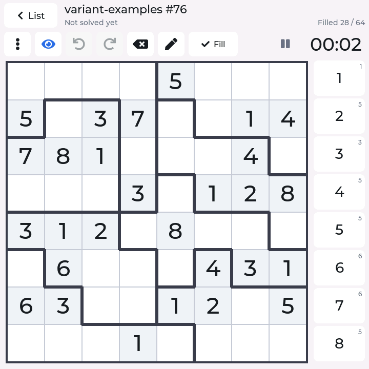
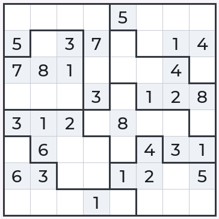

# Jigsaw 8×8

[← All variants](README.md) · [Puzzles](../features-puzzles.md) · [How to play](../how-to-play.md)

## The rules

An 8×8 grid with the digits 1 to 8: every **row**, every **column** and every **region** holds 1 to 8, each once. Instead of [Mini 8×8](mini-8x8.md)'s 2×4 boxes, the eight regions are **irregular shapes** of eight connected cells, outlined with thick lines, as in [Jigsaw](jigsaw.md). Every puzzle has its own regions.

## On the board

- An eight-key number pad; the regions are drawn with thick borders, as Jigsaw's.
- Hints call the regions "region 1" to "region 8".
- **Puzzles → ⋮ → New puzzle → Grids → Jigsaw 8x8**, at all four levels. Easy keeps 28 or more of the 64 cells. The regions are made by reshaping the 2×4 boxes, cell by cell, and drawn again while one still has seven or eight cells in a row or column.

## How to solve it

- The same steps as [Jigsaw](jigsaw.md): look for **hidden singles** region by region, then in the rows and columns.
- A busy row is a good start: a cell where its row, column and region show seven different digits has one left.
- **Count across lines:** any two rows hold 1-8 twice. Where a region lies wholly inside two rows, the other regions crossing those rows have to make up the rest.

## Worked example

**variant-examples #76**, Jigsaw 8×8 Easy (see [Classic](classic.md#worked-example-the-whole-puzzle) for how to import the examples; cells are written r*row*c*column*).

**Step 1: r2c5.** Row 2 has 5, 3, 7, 1 and 4; column 5 has the 8 in r5c5; its region has the 2 in r4c7. Only 6 is left: **r2c5 = 6**.

**Step 2: r3c5.** Row 3 has 7, 8, 1 and 4; column 5 has the 5 (r1c5) and the 6 just placed; its region has the 2 in r4c7. **r3c5 = 3**.

**Step 3: r3c6.** Row 3 now has 7, 8, 1, 3 and 4; column 6 has the 2 in r7c6. Of 5 and 6, its region already holds the 6 from step 1. **r3c6 = 5**.

## The whole puzzle, step by step

<!-- walkthrough -->
<!-- Written by tools/walkthrough.py jigsaw-8x8: edit the script, not this part. -->

The whole puzzle, from the start to the last cell: 36 steps, each one a single (one place left for a digit, or one digit left for a cell), taken in the order a box's single comes first, so not quite the order of the worked example above. Each step has a page of its own, with **Previous** and **Next**: pick its number below. In each picture, the unit the step looks at is tinted yellow (for a cell with one digit left: its row, column and box), the new digit is on green, the digits that rule cells out have an **orange ring**, and the empty cells they rule out a **red cross**. Givens are on grey, digits from earlier steps in blue.

| [1](jigsaw-8x8/step-01.md) | [2](jigsaw-8x8/step-02.md) | [3](jigsaw-8x8/step-03.md) | [4](jigsaw-8x8/step-04.md) | [5](jigsaw-8x8/step-05.md) | [6](jigsaw-8x8/step-06.md) | [7](jigsaw-8x8/step-07.md) | [8](jigsaw-8x8/step-08.md) | [9](jigsaw-8x8/step-09.md) | [10](jigsaw-8x8/step-10.md) |
|:-:|:-:|:-:|:-:|:-:|:-:|:-:|:-:|:-:|:-:|
| [11](jigsaw-8x8/step-11.md) | [12](jigsaw-8x8/step-12.md) | [13](jigsaw-8x8/step-13.md) | [14](jigsaw-8x8/step-14.md) | [15](jigsaw-8x8/step-15.md) | [16](jigsaw-8x8/step-16.md) | [17](jigsaw-8x8/step-17.md) | [18](jigsaw-8x8/step-18.md) | [19](jigsaw-8x8/step-19.md) | [20](jigsaw-8x8/step-20.md) |
| [21](jigsaw-8x8/step-21.md) | [22](jigsaw-8x8/step-22.md) | [23](jigsaw-8x8/step-23.md) | [24](jigsaw-8x8/step-24.md) | [25](jigsaw-8x8/step-25.md) | [26](jigsaw-8x8/step-26.md) | [27](jigsaw-8x8/step-27.md) | [28](jigsaw-8x8/step-28.md) | [29](jigsaw-8x8/step-29.md) | [30](jigsaw-8x8/step-30.md) |
| [31](jigsaw-8x8/step-31.md) | [32](jigsaw-8x8/step-32.md) | [33](jigsaw-8x8/step-33.md) | [34](jigsaw-8x8/step-34.md) | [35](jigsaw-8x8/step-35.md) | [36](jigsaw-8x8/step-36.md) |  |  |  |  |

Solved.

<!-- /walkthrough -->
