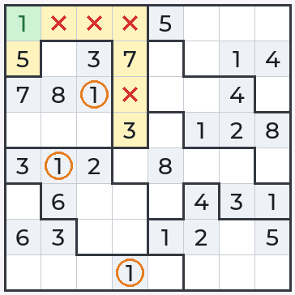

<!-- Written by tools/walkthrough.py jigsaw-8x8: edit the script, not this page. -->
# Jigsaw 8x8, step 1: the 1 in region 1

**Step 1 of 36** · [← The start](../jigsaw-8x8.md#the-whole-puzzle-step-by-step) · [All steps](../jigsaw-8x8.md#the-whole-puzzle-step-by-step) · [Step 2 →](step-02.md)

Region 1 needs a 1. r1c2: column 2 has one (r5c2). r1c3: column 3 has one (r3c3). r1c4: column 4 has one (r8c4). r3c4: row 3 has one (r3c3). Only **r1c1** is left: **r1c1 = 1**.

**Step 1 of 36** · [← The start](../jigsaw-8x8.md#the-whole-puzzle-step-by-step) · [All steps](../jigsaw-8x8.md#the-whole-puzzle-step-by-step) · [Step 2 →](step-02.md)
