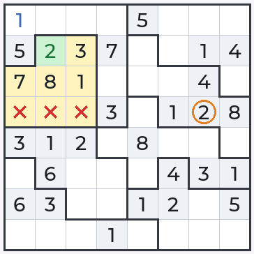

<!-- Written by tools/walkthrough.py jigsaw-8x8: edit the script, not this page. -->
# Jigsaw 8x8, step 2: the 2 in region 3

**Step 2 of 36** · [← Step 1](step-01.md) · [All steps](../jigsaw-8x8.md#the-whole-puzzle-step-by-step) · [Step 3 →](step-03.md)

Region 3 needs a 2. r4c1, r4c2 and r4c3: row 4 has one (r4c7). Only **r2c2** is left: **r2c2 = 2**.

**Step 2 of 36** · [← Step 1](step-01.md) · [All steps](../jigsaw-8x8.md#the-whole-puzzle-step-by-step) · [Step 3 →](step-03.md)
