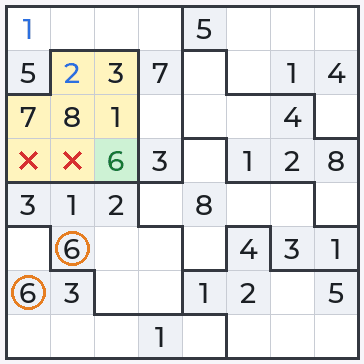

<!-- Written by tools/walkthrough.py jigsaw-8x8: edit the script, not this page. -->
# Jigsaw 8x8, step 3: the 6 in region 3

**Step 3 of 36** · [← Step 2](step-02.md) · [All steps](../jigsaw-8x8.md#the-whole-puzzle-step-by-step) · [Step 4 →](step-04.md)

Region 3 needs a 6. r4c1: column 1 has one (r7c1). r4c2: column 2 has one (r6c2). Only **r4c3** is left: **r4c3 = 6**.

**Step 3 of 36** · [← Step 2](step-02.md) · [All steps](../jigsaw-8x8.md#the-whole-puzzle-step-by-step) · [Step 4 →](step-04.md)
