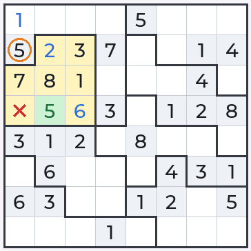

<!-- Written by tools/walkthrough.py jigsaw-8x8: edit the script, not this page. -->
# Jigsaw 8x8, step 4: the 5 in region 3

**Step 4 of 36** · [← Step 3](step-03.md) · [All steps](../jigsaw-8x8.md#the-whole-puzzle-step-by-step) · [Step 5 →](step-05.md)

Region 3 needs a 5. r4c1: column 1 has one (r2c1). Only **r4c2** is left: **r4c2 = 5**.

**Step 4 of 36** · [← Step 3](step-03.md) · [All steps](../jigsaw-8x8.md#the-whole-puzzle-step-by-step) · [Step 5 →](step-05.md)
