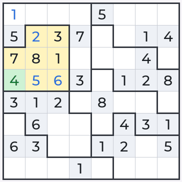

<!-- Written by tools/walkthrough.py jigsaw-8x8: edit the script, not this page. -->
# Jigsaw 8x8, step 5: the 4 in region 3

**Step 5 of 36** · [← Step 4](step-04.md) · [All steps](../jigsaw-8x8.md#the-whole-puzzle-step-by-step) · [Step 6 →](step-06.md)

Region 3 needs a 4, and r4c1 is its last empty cell: **r4c1 = 4**.

**Step 5 of 36** · [← Step 4](step-04.md) · [All steps](../jigsaw-8x8.md#the-whole-puzzle-step-by-step) · [Step 6 →](step-06.md)
