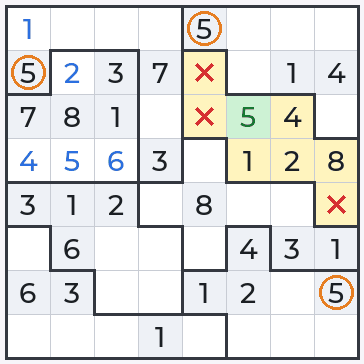

<!-- Written by tools/walkthrough.py jigsaw-8x8: edit the script, not this page. -->
# Jigsaw 8x8, step 6: the 5 in region 4

**Step 6 of 36** · [← Step 5](step-05.md) · [All steps](../jigsaw-8x8.md#the-whole-puzzle-step-by-step) · [Step 7 →](step-07.md)

Region 4 needs a 5. r2c5: row 2 has one (r2c1). r3c5: column 5 has one (r1c5). r5c8: column 8 has one (r7c8). Only **r3c6** is left: **r3c6 = 5**.

**Step 6 of 36** · [← Step 5](step-05.md) · [All steps](../jigsaw-8x8.md#the-whole-puzzle-step-by-step) · [Step 7 →](step-07.md)
