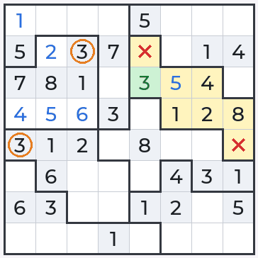

<!-- Written by tools/walkthrough.py jigsaw-8x8: edit the script, not this page. -->
# Jigsaw 8x8, step 7: the 3 in region 4

**Step 7 of 36** · [← Step 6](step-06.md) · [All steps](../jigsaw-8x8.md#the-whole-puzzle-step-by-step) · [Step 8 →](step-08.md)

Region 4 needs a 3. r2c5: row 2 has one (r2c3). r5c8: row 5 has one (r5c1). Only **r3c5** is left: **r3c5 = 3**.

**Step 7 of 36** · [← Step 6](step-06.md) · [All steps](../jigsaw-8x8.md#the-whole-puzzle-step-by-step) · [Step 8 →](step-08.md)
