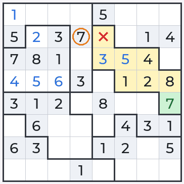

<!-- Written by tools/walkthrough.py jigsaw-8x8: edit the script, not this page. -->
# Jigsaw 8x8, step 8: the 7 in region 4

**Step 8 of 36** · [← Step 7](step-07.md) · [All steps](../jigsaw-8x8.md#the-whole-puzzle-step-by-step) · [Step 9 →](step-09.md)

Region 4 needs a 7. r2c5: row 2 has one (r2c4). Only **r5c8** is left: **r5c8 = 7**.

**Step 8 of 36** · [← Step 7](step-07.md) · [All steps](../jigsaw-8x8.md#the-whole-puzzle-step-by-step) · [Step 9 →](step-09.md)
