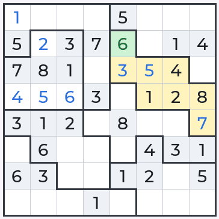

<!-- Written by tools/walkthrough.py jigsaw-8x8: edit the script, not this page. -->
# Jigsaw 8x8, step 9: the 6 in region 4

**Step 9 of 36** · [← Step 8](step-08.md) · [All steps](../jigsaw-8x8.md#the-whole-puzzle-step-by-step) · [Step 10 →](step-10.md)

Region 4 needs a 6, and r2c5 is its last empty cell: **r2c5 = 6**.

**Step 9 of 36** · [← Step 8](step-08.md) · [All steps](../jigsaw-8x8.md#the-whole-puzzle-step-by-step) · [Step 10 →](step-10.md)
