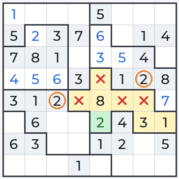

<!-- Written by tools/walkthrough.py jigsaw-8x8: edit the script, not this page. -->
# Jigsaw 8x8, step 10: the 2 in region 6

**Step 10 of 36** · [← Step 9](step-09.md) · [All steps](../jigsaw-8x8.md#the-whole-puzzle-step-by-step) · [Step 11 →](step-11.md)

Region 6 needs a 2. r4c5: row 4 has one (r4c7). r5c4, r5c6 and r5c7: row 5 has one (r5c3). Only **r6c5** is left: **r6c5 = 2**.

**Step 10 of 36** · [← Step 9](step-09.md) · [All steps](../jigsaw-8x8.md#the-whole-puzzle-step-by-step) · [Step 11 →](step-11.md)
