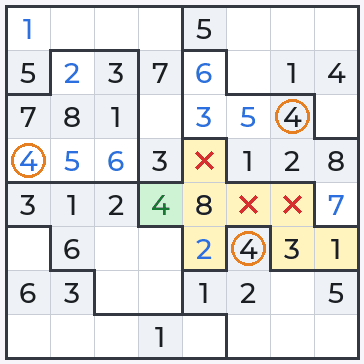

<!-- Written by tools/walkthrough.py jigsaw-8x8: edit the script, not this page. -->
# Jigsaw 8x8, step 11: the 4 in region 6

**Step 11 of 36** · [← Step 10](step-10.md) · [All steps](../jigsaw-8x8.md#the-whole-puzzle-step-by-step) · [Step 12 →](step-12.md)

Region 6 needs a 4. r4c5: row 4 has one (r4c1). r5c6: column 6 has one (r6c6). r5c7: column 7 has one (r3c7). Only **r5c4** is left: **r5c4 = 4**.

**Step 11 of 36** · [← Step 10](step-10.md) · [All steps](../jigsaw-8x8.md#the-whole-puzzle-step-by-step) · [Step 12 →](step-12.md)
