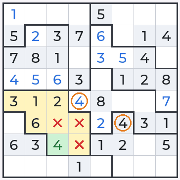

<!-- Written by tools/walkthrough.py jigsaw-8x8: edit the script, not this page. -->
# Jigsaw 8x8, step 12: the 4 in region 5

**Step 12 of 36** · [← Step 11](step-11.md) · [All steps](../jigsaw-8x8.md#the-whole-puzzle-step-by-step) · [Step 13 →](step-13.md)

Region 5 needs a 4. r6c3 and r6c4: row 6 has one (r6c6). r7c4: column 4 has one (r5c4). Only **r7c3** is left: **r7c3 = 4**.

**Step 12 of 36** · [← Step 11](step-11.md) · [All steps](../jigsaw-8x8.md#the-whole-puzzle-step-by-step) · [Step 13 →](step-13.md)
