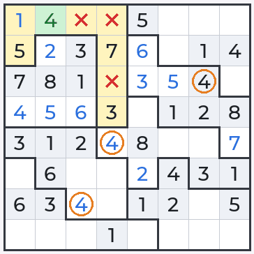

<!-- Written by tools/walkthrough.py jigsaw-8x8: edit the script, not this page. -->
# Jigsaw 8x8, step 13: the 4 in region 1

**Step 13 of 36** · [← Step 12](step-12.md) · [All steps](../jigsaw-8x8.md#the-whole-puzzle-step-by-step) · [Step 14 →](step-14.md)

Region 1 needs a 4. r1c3: column 3 has one (r7c3). r1c4: column 4 has one (r5c4). r3c4: row 3 has one (r3c7). Only **r1c2** is left: **r1c2 = 4**.

**Step 13 of 36** · [← Step 12](step-12.md) · [All steps](../jigsaw-8x8.md#the-whole-puzzle-step-by-step) · [Step 14 →](step-14.md)
