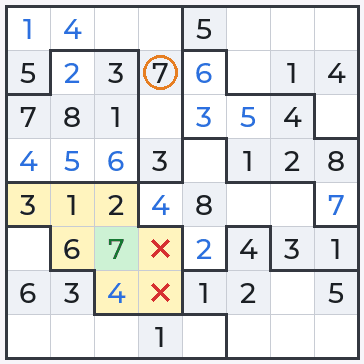

<!-- Written by tools/walkthrough.py jigsaw-8x8: edit the script, not this page. -->
# Jigsaw 8x8, step 14: the 7 in region 5

**Step 14 of 36** · [← Step 13](step-13.md) · [All steps](../jigsaw-8x8.md#the-whole-puzzle-step-by-step) · [Step 15 →](step-15.md)

Region 5 needs a 7. r6c4 and r7c4: column 4 has one (r2c4). Only **r6c3** is left: **r6c3 = 7**.

**Step 14 of 36** · [← Step 13](step-13.md) · [All steps](../jigsaw-8x8.md#the-whole-puzzle-step-by-step) · [Step 15 →](step-15.md)
