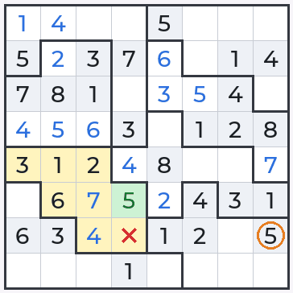

<!-- Written by tools/walkthrough.py jigsaw-8x8: edit the script, not this page. -->
# Jigsaw 8x8, step 15: the 5 in region 5

**Step 15 of 36** · [← Step 14](step-14.md) · [All steps](../jigsaw-8x8.md#the-whole-puzzle-step-by-step) · [Step 16 →](step-16.md)

Region 5 needs a 5. r7c4: row 7 has one (r7c8). Only **r6c4** is left: **r6c4 = 5**.

**Step 15 of 36** · [← Step 14](step-14.md) · [All steps](../jigsaw-8x8.md#the-whole-puzzle-step-by-step) · [Step 16 →](step-16.md)
