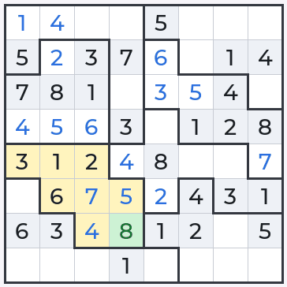

<!-- Written by tools/walkthrough.py jigsaw-8x8: edit the script, not this page. -->
# Jigsaw 8x8, step 16: the 8 in region 5

**Step 16 of 36** · [← Step 15](step-15.md) · [All steps](../jigsaw-8x8.md#the-whole-puzzle-step-by-step) · [Step 17 →](step-17.md)

Region 5 needs an 8, and r7c4 is its last empty cell: **r7c4 = 8**.

**Step 16 of 36** · [← Step 15](step-15.md) · [All steps](../jigsaw-8x8.md#the-whole-puzzle-step-by-step) · [Step 17 →](step-17.md)
