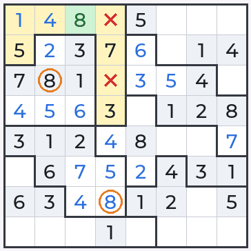

<!-- Written by tools/walkthrough.py jigsaw-8x8: edit the script, not this page. -->
# Jigsaw 8x8, step 17: the 8 in region 1

**Step 17 of 36** · [← Step 16](step-16.md) · [All steps](../jigsaw-8x8.md#the-whole-puzzle-step-by-step) · [Step 18 →](step-18.md)

Region 1 needs an 8. r1c4: column 4 has one (r7c4). r3c4: row 3 has one (r3c2). Only **r1c3** is left: **r1c3 = 8**.

**Step 17 of 36** · [← Step 16](step-16.md) · [All steps](../jigsaw-8x8.md#the-whole-puzzle-step-by-step) · [Step 18 →](step-18.md)
