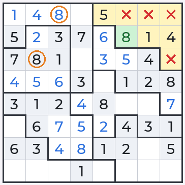

<!-- Written by tools/walkthrough.py jigsaw-8x8: edit the script, not this page. -->
# Jigsaw 8x8, step 18: the 8 in region 2

**Step 18 of 36** · [← Step 17](step-17.md) · [All steps](../jigsaw-8x8.md#the-whole-puzzle-step-by-step) · [Step 19 →](step-19.md)

Region 2 needs an 8. r1c6, r1c7 and r1c8: row 1 has one (r1c3). r3c8: row 3 has one (r3c2). Only **r2c6** is left: **r2c6 = 8**.

**Step 18 of 36** · [← Step 17](step-17.md) · [All steps](../jigsaw-8x8.md#the-whole-puzzle-step-by-step) · [Step 19 →](step-19.md)
