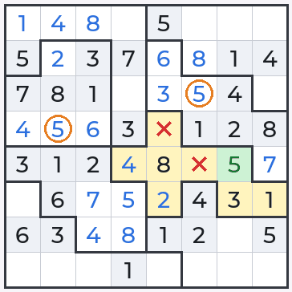

<!-- Written by tools/walkthrough.py jigsaw-8x8: edit the script, not this page. -->
# Jigsaw 8x8, step 19: the 5 in region 6

**Step 19 of 36** · [← Step 18](step-18.md) · [All steps](../jigsaw-8x8.md#the-whole-puzzle-step-by-step) · [Step 20 →](step-20.md)

Region 6 needs a 5. r4c5: row 4 has one (r4c2). r5c6: column 6 has one (r3c6). Only **r5c7** is left: **r5c7 = 5**.

**Step 19 of 36** · [← Step 18](step-18.md) · [All steps](../jigsaw-8x8.md#the-whole-puzzle-step-by-step) · [Step 20 →](step-20.md)
