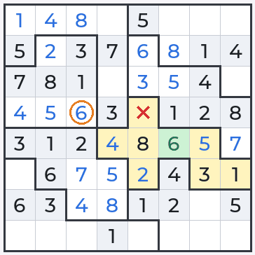

<!-- Written by tools/walkthrough.py jigsaw-8x8: edit the script, not this page. -->
# Jigsaw 8x8, step 20: the 6 in region 6

**Step 20 of 36** · [← Step 19](step-19.md) · [All steps](../jigsaw-8x8.md#the-whole-puzzle-step-by-step) · [Step 21 →](step-21.md)

Region 6 needs a 6. r4c5: row 4 has one (r4c3). Only **r5c6** is left: **r5c6 = 6**.

**Step 20 of 36** · [← Step 19](step-19.md) · [All steps](../jigsaw-8x8.md#the-whole-puzzle-step-by-step) · [Step 21 →](step-21.md)
