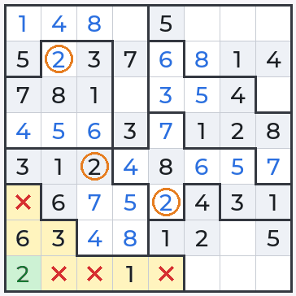

<!-- Written by tools/walkthrough.py jigsaw-8x8: edit the script, not this page. -->
# Jigsaw 8x8, step 22: the 2 in region 7

**Step 22 of 36** · [← Step 21](step-21.md) · [All steps](../jigsaw-8x8.md#the-whole-puzzle-step-by-step) · [Step 23 →](step-23.md)

Region 7 needs a 2. r6c1: row 6 has one (r6c5). r8c2: column 2 has one (r2c2). r8c3: column 3 has one (r5c3). r8c5: column 5 has one (r6c5). Only **r8c1** is left: **r8c1 = 2**.

**Step 22 of 36** · [← Step 21](step-21.md) · [All steps](../jigsaw-8x8.md#the-whole-puzzle-step-by-step) · [Step 23 →](step-23.md)
