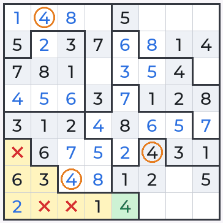

<!-- Written by tools/walkthrough.py jigsaw-8x8: edit the script, not this page. -->
# Jigsaw 8x8, step 23: the 4 in region 7

**Step 23 of 36** · [← Step 22](step-22.md) · [All steps](../jigsaw-8x8.md#the-whole-puzzle-step-by-step) · [Step 24 →](step-24.md)

Region 7 needs a 4. r6c1: row 6 has one (r6c6). r8c2: column 2 has one (r1c2). r8c3: column 3 has one (r7c3). Only **r8c5** is left: **r8c5 = 4**.

**Step 23 of 36** · [← Step 22](step-22.md) · [All steps](../jigsaw-8x8.md#the-whole-puzzle-step-by-step) · [Step 24 →](step-24.md)
