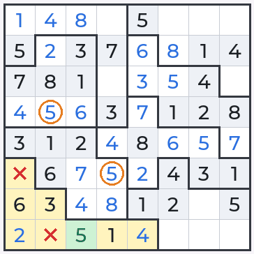

<!-- Written by tools/walkthrough.py jigsaw-8x8: edit the script, not this page. -->
# Jigsaw 8x8, step 24: the 5 in region 7

**Step 24 of 36** · [← Step 23](step-23.md) · [All steps](../jigsaw-8x8.md#the-whole-puzzle-step-by-step) · [Step 25 →](step-25.md)

Region 7 needs a 5. r6c1: row 6 has one (r6c4). r8c2: column 2 has one (r4c2). Only **r8c3** is left: **r8c3 = 5**.

**Step 24 of 36** · [← Step 23](step-23.md) · [All steps](../jigsaw-8x8.md#the-whole-puzzle-step-by-step) · [Step 25 →](step-25.md)
