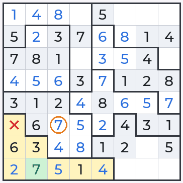

<!-- Written by tools/walkthrough.py jigsaw-8x8: edit the script, not this page. -->
# Jigsaw 8x8, step 25: the 7 in region 7

**Step 25 of 36** · [← Step 24](step-24.md) · [All steps](../jigsaw-8x8.md#the-whole-puzzle-step-by-step) · [Step 26 →](step-26.md)

Region 7 needs a 7. r6c1: row 6 has one (r6c3). Only **r8c2** is left: **r8c2 = 7**.

**Step 25 of 36** · [← Step 24](step-24.md) · [All steps](../jigsaw-8x8.md#the-whole-puzzle-step-by-step) · [Step 26 →](step-26.md)
