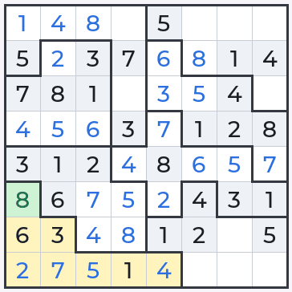

<!-- Written by tools/walkthrough.py jigsaw-8x8: edit the script, not this page. -->
# Jigsaw 8x8, step 26: the 8 in region 7

**Step 26 of 36** · [← Step 25](step-25.md) · [All steps](../jigsaw-8x8.md#the-whole-puzzle-step-by-step) · [Step 27 →](step-27.md)

Region 7 needs an 8, and r6c1 is its last empty cell: **r6c1 = 8**.

**Step 26 of 36** · [← Step 25](step-25.md) · [All steps](../jigsaw-8x8.md#the-whole-puzzle-step-by-step) · [Step 27 →](step-27.md)
