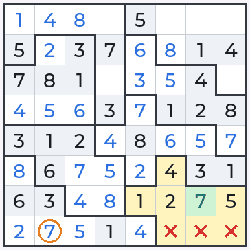

<!-- Written by tools/walkthrough.py jigsaw-8x8: edit the script, not this page. -->
# Jigsaw 8x8, step 27: the 7 in region 8

**Step 27 of 36** · [← Step 26](step-26.md) · [All steps](../jigsaw-8x8.md#the-whole-puzzle-step-by-step) · [Step 28 →](step-28.md)

Region 8 needs a 7. r8c6, r8c7 and r8c8: row 8 has one (r8c2). Only **r7c7** is left: **r7c7 = 7**.

**Step 27 of 36** · [← Step 26](step-26.md) · [All steps](../jigsaw-8x8.md#the-whole-puzzle-step-by-step) · [Step 28 →](step-28.md)
