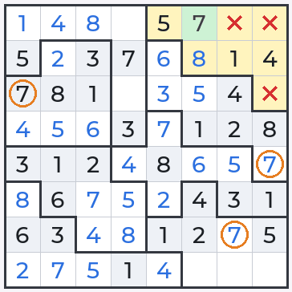

<!-- Written by tools/walkthrough.py jigsaw-8x8: edit the script, not this page. -->
# Jigsaw 8x8, step 28: the 7 in region 2

**Step 28 of 36** · [← Step 27](step-27.md) · [All steps](../jigsaw-8x8.md#the-whole-puzzle-step-by-step) · [Step 29 →](step-29.md)

Region 2 needs a 7. r1c7: column 7 has one (r7c7). r1c8: column 8 has one (r5c8). r3c8: row 3 has one (r3c1). Only **r1c6** is left: **r1c6 = 7**.

**Step 28 of 36** · [← Step 27](step-27.md) · [All steps](../jigsaw-8x8.md#the-whole-puzzle-step-by-step) · [Step 29 →](step-29.md)
