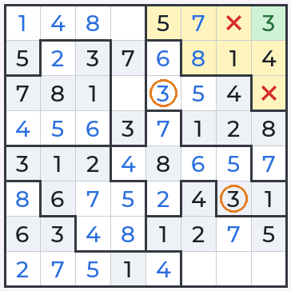

<!-- Written by tools/walkthrough.py jigsaw-8x8: edit the script, not this page. -->
# Jigsaw 8x8, step 29: the 3 in region 2

**Step 29 of 36** · [← Step 28](step-28.md) · [All steps](../jigsaw-8x8.md#the-whole-puzzle-step-by-step) · [Step 30 →](step-30.md)

Region 2 needs a 3. r1c7: column 7 has one (r6c7). r3c8: row 3 has one (r3c5). Only **r1c8** is left: **r1c8 = 3**.

**Step 29 of 36** · [← Step 28](step-28.md) · [All steps](../jigsaw-8x8.md#the-whole-puzzle-step-by-step) · [Step 30 →](step-30.md)
