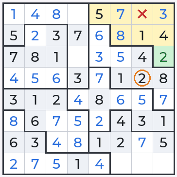

<!-- Written by tools/walkthrough.py jigsaw-8x8: edit the script, not this page. -->
# Jigsaw 8x8, step 30: the 2 in region 2

**Step 30 of 36** · [← Step 29](step-29.md) · [All steps](../jigsaw-8x8.md#the-whole-puzzle-step-by-step) · [Step 31 →](step-31.md)

Region 2 needs a 2. r1c7: column 7 has one (r4c7). Only **r3c8** is left: **r3c8 = 2**.

**Step 30 of 36** · [← Step 29](step-29.md) · [All steps](../jigsaw-8x8.md#the-whole-puzzle-step-by-step) · [Step 31 →](step-31.md)
